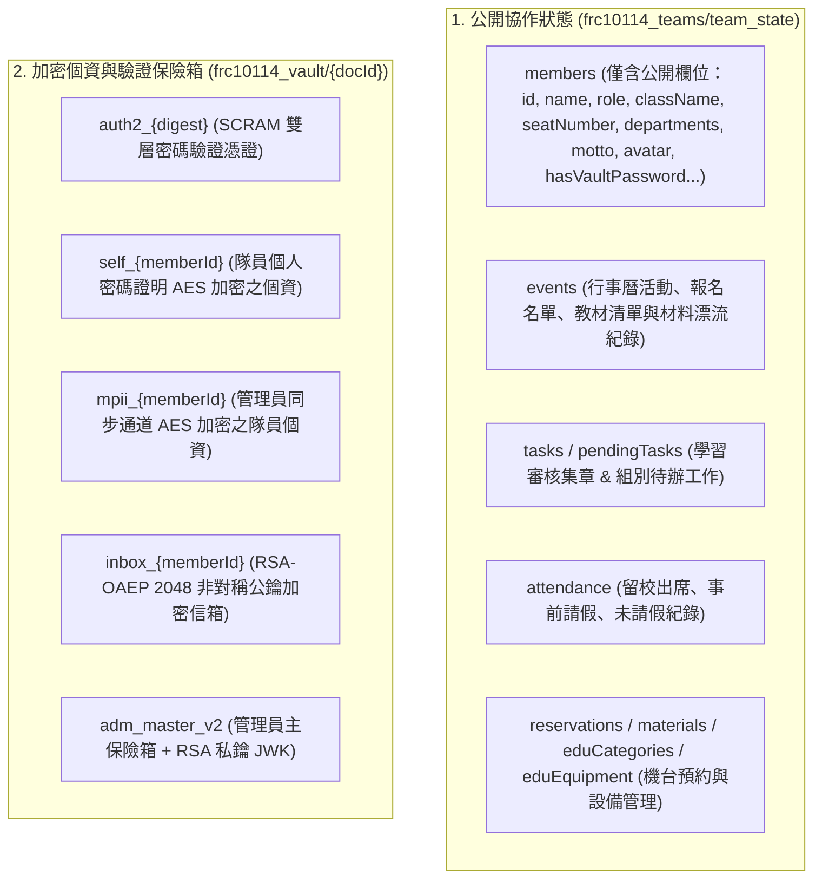

# 🤖 FRC 10114 隊務管理系統 — AI 交接與系統架構總覽 (`AI_ARCHITECTURE_AND_HANDOVER.md`)

> **⚠️ 給所有接手本專案的 AI 代理（AI Agent Mandatory Directive）**
> 1. **在修改任何程式碼之前，必須完整閱讀本文件。**
> 2. **每次完成任何功能新增、架構調整或 Bug 修復後，你必須主動更新本文件**（包含更新「元件行號索引表」與在底部「歷次修改紀錄 Changelog」新增一筆紀錄），並連同程式碼一起 Commit 推送至 GitHub。
> 3. **嚴格遵守【嚴格驗證交付模式】**：
>    - 嚴禁在未經邏輯推演與實測前直接宣稱「已完成」。
>    - 交付前必須完成：**① 路徑乾跑 (Path Dry-Run)**、**② 失敗與邊界驗證 (Edge Cases)**、**③ `@babel/standalone` 語法編譯與自我修正**。
>    - 回覆使用者時，必須附上一小段 **「驗證結果摘要」** 表格。

---

## 1. 🚨 核心禁忌與防呆警告（AI 絕對不可踩的雷）

1. **`index.html` 是唯一的前端真實來源（Single Source of Truth）！**
   - 本系統前端為單一檔案架構（Single-File React 18 SPA），所有 HTML、CSS、安全加解密引擎與 React 元件皆位於根目錄的 [`index.html`](./index.html)（約 22,116 行）。
   - **嚴禁修改 `src/` 目錄下的任何檔案**！`src/` 與 `vite.config.ts` 僅為最初建置時遺留的空殼，生產環境（Vercel）與本地伺服器（[`server.js`](./server.js)）皆直接載入根目錄的 [`index.html`](./index.html)。
2. **嚴禁將隊員敏感個資（PII）或密碼寫入 `frc10114_teams/team_state`！**
   - 敏感個資（`phone`, `parentPhone`, `birthday`, `idNumber`, `email`, `skills`, `passwordHash`, `parentPasswordHash`）**只能**加密存放在獨立集合 `frc10114_vault/{docId}`。
   - `encodeMembersForStorage()` 會在寫入 `team_state.members` 前自動剝離所有敏感欄位，任何新增的個資欄位都必須列入 `SENSITIVE_PII_FIELDS`。
3. **修改 `team_state` 頂層欄位時，必須同步檢查 [`firestore.rules`](./firestore.rules)！**
   - [`firestore.rules`](./firestore.rules) 嚴格限制 `frc10114_teams/team_state` 僅允許以下 11 個頂層鍵值：
     `['members', 'events', 'tasks', 'pendingTasks', 'materials', 'attendance', 'reservations', 'eduCategories', 'eduEquipment', 'updatedAt', 'updatedBy']`。
   - 若往 `team_state` 寫入未列於白名單的頂層欄位，Firestore 會直接拒絕整筆寫入（`PERMISSION_DENIED`）！
4. **注意 `frc10114_vault` 的 Firestore 安全規則限制：**
   - [`firestore.rules`](./firestore.rules) 中 `frc10114_vault/{docId}` 設定為 **`allow get: if true; allow list: if false;`**。
   - 這代表**絕對不能對 `frc10114_vault` 使用 `.where(...)` 或 `.get()` 查詢整個集合**（會觸發 `PERMISSION_DENIED`），只能透過已知的 `docId` 執行單筆 `vaultCol.doc(docId).get()`！
5. **React Hooks 引用規範：**
   - 由於本專案使用瀏覽器端 UMD 版 React（無 ES Module `import`），頂層 L293 已解構 `const { useState, useEffect, useMemo, useRef, useCallback } = React;`。若元件內需使用其他 React API，請務必使用 `React.xxx` 或確認已於 L293 頂層解構，切勿直接呼叫未解構之識別字（否則進入分頁時會觸發 `ReferenceError` 導致畫面空白）。

---

## 2. 🌐 系統環境、部署與外部串接資訊

| 項目 | 設定值 / 路徑 | 說明 |
| :--- | :--- | :--- |
| **GitHub 遠端儲存庫 (`origin`)** | `https://github.com/QXJHSH/teamManage.git` | 主分支為 `main`，推送後自動觸發 Vercel 生產環境部署。 |
| **Vercel 正式網址** | `https://frc10114-team-manage.vercel.app` | 由 [`vercel.json`](./vercel.json) 控制路由與資安標頭（CSP / HSTS）。 |
| **Vercel 後端 Serverless API** | [`api/submit-sheet.js`](./api/submit-sheet.js) | 路由 `/api/submit-sheet`，支援 `POST` 與 `GET`，負責將明日留校名單轉發至 Google Apps Script。 |
| **本地開發伺服器** | [`server.js`](./server.js) (`node server.js`) | 預設監聽 `http://localhost:5173`，內建 `/api/submit-sheet` 代理與 CSP 標頭。 |
| **Firebase 專案 ID** | `frc10114-team-manage` | 設定檔位於 [`firebase-config.json`](./firebase-config.json) 與 `index.html` 的 `DEFAULT_FIREBASE_CONFIG`。 |
| **Google 試算表 ID** | `15zw5HdajgYVGS4odRv8qQeoPPtItgM04bTMOQACsqGg` | 工作表名稱：`明日申請在校名單`，寫入目標儲存格：`A1`。 |
| **LINE 推播群組 ID** | 家長群：`C990455b30e8f36f3fe9480da689e3a99`<br>學生群：`C43bacd2f0e75d4df6679ae19c9134ba7` | 由 Google 試算表內的 Apps Script (`sendLineAnnouncement`) 於每日 21:00–22:00 自動推播。 |

---

## 3. 🔐 資料架構與雙層加密保險箱（Dual-Collection Vault Architecture）

系統將雲端 Firestore 資料分為兩個獨立集合，兼顧「多人即時協作同步」與「零知識等級個資保護」：



### 3.1 密碼雜湊與登入驗證流程 (`verifyAccountCredential`)
- **預設密碼**：
  - 管理員預設密碼：`admin10114`（對應 `DEFAULT_ADMIN_ENC`）
  - 隊員與家長預設密碼：`10114`（對應 `DEFAULT_MEMBER_ENC`）
- **雙層雜湊（SCRAM-style）**：
  1. `deriveClientProof(plain, memberId)` ➔ 產生客戶端證明 `H1`（僅存於記憶體與當前 `sessionStorage`，絕不落地雲端）。
  2. `hashPassword(plain, memberId)` ➔ 產生驗證雜湊 `H2`（用於計算 `getVaultAuthDocId(role, memberId, plain, useDynamicSalt)`）。
- **登入防爆破（Brute-Force Guard）**：
  - `readLoginGuardState()` / `writeLoginGuardState()` 同時在記憶體、`localStorage`、`sessionStorage` 與 `window.name` 寫入帶 HMAC 簽章的失敗計數，連續錯誤達上限即鎖定。

### 3.2 隊員個資（PII）儲存與管理員跨端解密流程
1. **隊員端儲存個人資料 (`handleUpdateProfile` ➔ `saveMemberVaultData`)**：
   - **通道 1 (本地快取)**：`saveLocalVaultPii(memberId, proof, myPii)` 寫入瀏覽器 `localStorage`，確保同裝置離線或重整也能秒開。
   - **通道 2 (`self_{memberId}`)**：以隊員自己的 `memberProof` 加密寫入 `frc10114_vault/self_{memberId}`，確保隊員換裝置登入也能還原自己的個資。
   - **通道 3 (`mpii_{memberId}`)**：以團隊管理員共享衍生金鑰加密寫入 `frc10114_vault/mpii_{memberId}`，供管理員直接批次讀取。
   - **通道 4 (`inbox_{memberId}`)**：若存在管理員 RSA 公鑰 (`adm_pubkey_v1`)，額外以 RSA-OAEP 2048 加密寫入 `frc10114_vault/inbox_{memberId}`。
2. **管理員端讀取與匯出全部隊員個資 (`unlockSessionVault` & `fetchMemberVaultPii`)**：
   - 當管理員登入、切換至「隊員管理 (`activeTab === 'members'`)」、收到雲端 `onSnapshot` 更新、或點擊「匯出隊員名單 CSV (`handleExportMembersList`)」時：
   - 系統會自動對全體隊員並行讀取 `mpii_{id}`（若無則自動 fallback 解密 `inbox_{id}` 與 `adm_master_v2`），將解密後的個資寫入 `unlockedPiiRef.current` 並更新 `members` state，確保管理員畫面與 CSV 匯出 100% 包含最新隊員個資。

---

## 4. ⚡ 多人併發控制與智慧合併引擎 (`smartMergeField`)

為了防止多位學生或管理員同時在線上操作時發生「後寫覆蓋前寫（Lost Update）」，[`index.html`](./index.html) 實作了雙重防護：

1. **細粒度欄位更新 (`syncToCloud(overrideData)`)**：
   - 每次操作（例如新增一筆考勤、修改一個活動、借還一台設備）只傳遞變更的頂層欄位（如 `syncToCloud({ attendance: next })`），不會把未變更的其他欄位整包覆寫。
2. **Firestore Transaction 智慧陣列合併 (`smartMergeField`)**：
   - 在寫入雲端前，系統會比對 `remoteVal`（雲端最新值）、`prevVal`（本地修改前快照）與 `nextVal`（本地修改後目標值）：
     - 若本地新增了某個 `id` 的項目，會自動保留雲端其他人同時新增的項目。
     - 若本地明確刪除了某個 `id`（存在於 `prevVal` 但不在 `nextVal`），則從雲端陣列中移除該項。
     - 針對 `events` 中的「教材準備與材料漂流紀錄 (`id.startsWith('drift-')`)」，在合併時會透過 `deduplicateDriftEvents()` 自動合併同日期、同課程名稱的材料項目。

---

## 5. 📅 重點功能模組邏輯說明

### 5.1 行事曆與教材準備清單（4 大子分頁）
位於 `AdminCalendarTab`（管理員）與 `MemberCalendarTab`（學生唯讀檢視）：
- **子分頁 1 (`upcoming`)**：近期行程與活動報名。
- **子分頁 2 (`past`)**：歷史行程回顧。
- **子分頁 3 (`overview`)**：月曆總覽視圖 (`MonthCalendarView`)。
- **子分頁 4 (`materials`)**：**教材準備清單**，內部分為上下兩區：
  1. **活動教材準備區**：讀取一般行事曆活動中的 `materialItems`（支援單一活動多筆教材與數量）。
  2. **材料漂流紀錄區 (`drift-*`)**：支援「多行文字批次匯入 (`parseMultiLineDriftText`)」，可自動解析如 `114.10.22前寄達 國中生科37份、高中生科35份` 的文字，自動歸戶至標準教材分類（包含將「紙電路－發光卡片」統一歸併為「**發光卡片**」），並提供「待寄出總表統計卡片」、「已寄出確認彈窗 (`shipped: true`)」與「已寄出歷史紀錄摺疊區」。

### 5.2 留校考勤與 Google 試算表 / LINE 自動同步
位於 `AdminAttendanceTab`、`MemberAttendanceTab` 與 [`api/submit-sheet.js`](./api/submit-sheet.js)：
- **報名截止鎖定 (`isAttendanceLocked`)**：每日留校申請／取消於**前一日晚上 21:00** 截止鎖定。
- **姓名格式化與排序 (`formatStudentWithClass` & `sortStudentsByClassOrder`)**：
  - 自動將班級（如 `高一6班` ➔ `106`）與座號（補零 2 碼，如 `8` ➔ `08`）組合為 `10608張尹嘉`。
  - 依「班級數字 ➔ 座號數字 ➔ 姓名筆劃」排序，自動過濾無人申請的時段，並對同名紀錄自動去重（`[...new Set(...)]`）。
- **三層自動同步機制**：
  1. **網頁即時觸發 (`autoSyncTomorrowAttendanceToSheet`)**：只要學生或管理員新增/取消留校，或開啟網頁載入最新雲端考勤時發現明日名單有異動，前端立即在背景呼叫 `/api/submit-sheet` 更新試算表 `A1`。
  2. **Vercel 後端代理 (`/api/submit-sheet`)**：支援前端 `POST` 轉發，亦支援直接 `GET /api/submit-sheet` 由後端自動向 Firestore 抓取明日名單並寫入試算表。
  3. **Google Apps Script 排程**：試算表內建 `syncAttendanceToSheet`（每 30 分鐘自動抓取寫入 `A1`）與 `sendLineAnnouncement`（每晚 21:00–22:00 推播至家長群與學生群）。

### 5.3 材料／設備購買申請系統 (`PurchaseRequestForm`)
位於 `UnifiedEquipmentModule` 的第 4 子分頁（`mainTab === 'purchase'`）：
- **雲端資料結構（相容 `firestore.rules` 與 `smartMergeField`）**：
  - 購買申請品項儲存於 `frc10114_teams/team_state.materials` 陣列中，並以 `recordType: 'purchase_request'` 及 `id: 'preq-...'` 與一般實體耗材庫存（`mat-...`）嚴格區隔（透過 `isPurchaseRequestRecord(m)` 判斷）。
  - 一般庫存表格（第 3 子分頁）與 `DataExportModal` 耗材 CSV 匯出均自動過濾掉 `isPurchaseRequestRecord(m)`，確保庫存數據純淨。
- **隊員端流程 (`!isAdmin`)**：
  - 購買申請人自動綁定目前登入帳號之姓名與學號（`currentMember.name` / `currentMember.id`），無需手動填寫。隊員僅需填寫「標題（購買專案）」與多筆品項（名稱、正整數數量、規格、購買連結）後送出，即刻寫入雲端並於下方「我的材料／設備購買申請紀錄」顯示 **`⏳ 申請中 (等待教師採購)`**。
  - 在教師勾選已購買前，隊員可隨時點擊 **「✏️ 取消並重新編輯」**（將該品項自雲端撤回，並自動將原填寫內容完整帶回上方表單供修改後重送），或點擊 **「🗑️ 取消申請」** 刪除。
- **管理員／教師端流程 (`isAdmin`)**：
  - 自動匯集全隊所有隊員送出的購買需求，顯示申請人姓名/學號、購買專案、品項名稱、數量、規格與外部購買連結，並支援狀態篩選（待購買 / 已購買 / 全部）、申請人篩選、關鍵字搜尋與 Excel (`.xlsx`) 匯出。
  - 教師可直接點擊左側 **「勾選已購買」** 核取方塊，即可將狀態標記為 **`status: 'purchased'`**（記錄 `purchasedAt` 與 `purchasedBy`），並即時同步更新至隊員端畫面鎖定為「✅ 已購買完成」。

---

## 6. 📍 [`index.html`](./index.html) 元件與函式行號索引表（Code Map）

> 💡 **AI 提示**：在閱讀或修改 [`index.html`](./index.html) 時，請直接使用 `read_file` 指定下表對應的 `StartLine` 與 `EndLine`，切勿盲目讀取整個檔案。

| 行號範圍 (約略) | 函式 / 元件名稱 | 職責說明 |
| :--- | :--- | :--- |
| `L295 - L544` | `encodeSecret`, `decodeSecret`, `rawDigest256`, `deriveClientProof`, `hashPassword`, `vaultEncrypt`, `vaultDecrypt`, `SENSITIVE_PII_FIELDS` | 密碼雜湊、加鹽衍生、AES-GCM 風格串流加解密與敏感個資欄位定義。 |
| `L545 - L755` | `isSessionExpired`, `clearAllAuthSessionCache`, `readLoginGuardState`, `getSessionWebhookUrl` | 2 小時 Session 逾時管理、防暴力破解鎖定器、Webhook URL 持久化儲存。 |
| `L789 - L935` | `createSessionSig`, `verifySessionSig`, `encodeMembersForStorage`, `normalizeMembersFromStorage` | Session 簽章驗證、寫入雲端前剝離 PII、從保險箱解密合併 PII。 |
| `L938 - L1930` | `INITIAL_MEMBERS`, `INITIAL_EVENTS`, `INITIAL_TASKS`, `INITIAL_MATERIALS`, `INITIAL_ATTENDANCE` | 系統預設初始種子資料。 |
| `L1932 - L2055` | `sanitizeCSVCell`, `exportToCSV`, `initFirestore` | CSV 公式注入防護（防 `=`, `+`, `-`, `@`）、檔案匯出與 Firebase 初始化。 |
| `L2061 - L2915` | `verifyAccountCredential`, `fetchMemberVaultPii`, `unlockSessionVault`, `saveAdminVaultData`, `saveMemberVaultData`, `rotateVaultPassword` | **核心加密保險箱引擎 (`frc10114_vault`)**：登入驗證、隊員個資多通道寫入、管理員批次與單點解密、密碼變更輪替。 |
| `L2921 - L3060` | `smartMergeField` | 多人同時在線編輯時的陣列差異比對與無損合併演算法。 |
| `L3065 - L6528` | `App()` | 主應用程式狀態中心、雲端 `onSnapshot` 監聽、隊員新增/刪除 (`handleDeleteMember`)、個資儲存 (`handleUpdateProfile`)、CSV 匯出 (`handleExportMembersList`) 與分頁路由。 |
| `L6529 - L8173` | `isPurchaseRequestRecord`, `UnifiedEquipmentModule` | 機台預約、教學設備借還、材料庫存及購買申請分頁（含待購/申請中數量徽章）。 |
| `L8174 - L9005` | `createBlankPurchaseItem`, `PurchaseRequestForm` | 隊員端多品項購買申請送出、申請中狀態追蹤、取消並重新編輯；管理員端全隊需求匯總、勾選已購買與 Excel 匯出。 |
| `L9008 - L9616` | `MonthCalendarView`, `normalizeCourseName`, `parseMultiLineDriftText`, `computeMaterialSummaryByCourse` | 月曆視圖與「教材準備 / 材料漂流」文字解析、分類正規化（發光卡片統一）與待寄統計。 |
| `L9622 - L12296` | `AdminCalendarTab` | 管理員行事曆、活動教材管理、材料漂流多行匯入與已寄出確認。 |
| `L12298 - L13801` | `AdminTaskReviewTab` | 管理員學習任務審核集章與組別待完成工作管理。 |
| `L13806 - L15171` | `buildAttendanceSheetPayload`, `autoSyncTomorrowAttendanceToSheet`, `AdminAttendanceTab` | 明日留校名單排版、班級座號排序、自動同步試算表與 Apps Script 範本產生器。 |
| `L15174 - L16241` | `MemberProfileTab` | 隊員與管理員個人資料編輯、座右銘、頭像上傳與密碼修改介面。 |
| `L16245 - L17466` | `MemberCalendarTab` | 隊員端行事曆檢視、活動報名與教材準備清單唯讀檢視。 |
| `L17470 - L18166` | `MemberLearningTab`, `MemberTasksTab`, `MemberAttendanceTab` | 隊員端學習集章、工作認領與到校留校/請假申請。 |
| `L18168 - L18901` | `ParentPortalTab`, `ParentAttendanceTab` | 家長關心通道首頁、孩子出勤查閱與家長密碼變更。 |
| `L18905 - L21216` | `MemberImportModal`, `OfficeToolsTab` | 辦公工具組：公假單產生器、活動簽到表產生器、開會通知單產生器（支援匯入隊員名單）。 |
| `L21221 - L22900` | `DataExportModal`, `AddAdminModal`, `FirebaseConfigModal`, `RoleLoginModal` | 系統 JSON 備份還原、新增管理員、雲端連線設定與登入入口閘門。 |

---

## 7. 🧪 修改程式碼後的標準驗證指令

每次修改完 [`index.html`](./index.html)、[`api/submit-sheet.js`](./api/submit-sheet.js) 或 [`server.js`](./server.js) 後，AI 必須在終端機執行以下檢查確認無誤：

1. **檢查後端 JS 語法**：
   ```powershell
   node --check server.js; node --check api/submit-sheet.js
   ```
2. **檢查 `index.html` JSX 完整性（使用 `@babel/standalone` 編譯測試）**：
   提取 `<script type="text/babel">` 區塊並透過 `@babel/standalone` 執行 `Babel.transform(jsxCode, { presets: ['react'] })` 與 `new vm.Script(compiled)`，確保沒有任何未閉合的 JSX 標籤或語法錯誤。

---

## 8. 📜 歷次重要修改紀錄（Changelog）

> 📌 **規範**：未來任何 AI 完成修改後，請在下方表格**最上方（最新日期）**新增一筆紀錄。

| 日期 | Commit | 修改模組 | 修改內容與解決的問題摘要 |
| :--- | :--- | :--- | :--- |
| **2026-11-18** | 最新 | 教學設備編號一覽表 & 購買申請雲端協作 (`UnifiedEquipmentModule` / `PurchaseRequestForm`) | 1. 將「2. 教學設備」下的設備編號一覽表改為電腦與手機皆為單欄垂直列表（`flex flex-col space-y-2`），並依編號數字自然排序由上往下逐列呈現，方便快速查找設備與借用人資訊。<br>2. 將「4. 材料／設備購買申請」升級為雲端即時同步系統（以 `recordType: 'purchase_request'` 與 `id: 'preq-*'` 儲存於 `materials`，完美相容 `firestore.rules` 與 `smartMergeField` 多人併發合併）。<br>3. **隊員端**：購買申請人自動綁定登入帳號名稱（免手動填寫），支援新增多筆品項後送出，於畫面下方即時顯示「⏳ 申請中」或「✅ 已購買」狀態；申請中品項可點擊「✏️ 取消並重新編輯」或「🗑️ 取消申請」。<br>4. **管理員／教師端**：自動匯集全隊所有隊員申請需求，顯示申請人、專案標題、品項、數量、規格與購買連結，支援教師直接勾選「已購買」完成採購並同步更新隊員畫面。 |
| **2026-11-18** | `7dd6acd` | 材料／設備購買申請 | 新增管理員與隊員共用的購買申請分頁，可填寫多筆品項並下載含六欄的 Excel 活頁簿。申請資料由瀏覽器直接匯出。 |
| **2026-11-18** | `f7e169b` / `35c8862` | 部署來源切換 & 考勤名單去重 | 1. 將 Git 遠端儲存庫與 Vercel 部署來源正式遷移至 `https://github.com/QXJHSH/teamManage.git`。<br>2. 於 `index.html` 與 `api/submit-sheet.js` 對匯出之各時段留校名單加入 `[...new Set(...)]` 去重，防止因舊版學號重疊產生重複姓名。<br>3. 建立本交接文件 `AI_ARCHITECTURE_AND_HANDOVER.md` 與 `AGENTS.md`。 |
| **2026-11-15** | `ef9f85d` | 留校名單自動同步 Google 試算表 & LINE | 1. 修復 `GOOGLE_SPREADSHEET_ID` 空值問題與登出誤刪 Webhook URL 問題。<br>2. 新增 `autoSyncTomorrowAttendanceToSheet()`，當學生/管理員登記或取消留校、或載入雲端考勤有異動時，自動於背景呼叫 `/api/submit-sheet` 同步至試算表 `A1`。<br>3. 升級 `api/submit-sheet.js` 支援 `GET` 自動抓取 Firestore 並排版寫入試算表。<br>4. 更新 Apps Script 範本，同時相容 `syncAttendanceToSheet`（每 30 分鐘同步）與 `sendLineAnnouncement`（每日 21:00 LINE 推播）。 |
| **2026-11-06** | `41ba7bf` / `fb185b9` / `9dcfc84` | 隊員個資保險箱 (`frc10114_vault`) 與管理員 CSV 匯出 | 1. 解決隊員儲存個人資料後登出消失、以及管理員端看不到隊員個資與 CSV 匯出空白的問題。<br>2. 實作雙層本地+雲端多通道保險箱（`self_`, `mpii_`, `inbox_`），並避開 `firestore.rules` 對 `frc10114_vault` 的 `allow list: if false` 限制，改為依 `member.id` 逐筆並行 `.doc().get()`。<br>3. 於管理員登入、`onSnapshot`、切換至 `members` 分頁及匯出 CSV 前自動解鎖全部隊員個資。 |
| **2026-11-05** | `b0694cd` | 管理員隊員管理 (`handleDeleteMember`) | 新增管理員刪除離隊隊員按鈕與二次確認對話框，禁止刪除自己或預設主管理員 (`10114-001`)，並同步清理雲端保險箱殘留資料。 |
| **2026-11-05** | `e106cda` / `7c6abc7` / `51d7754` | 行事曆教材準備與材料漂流管理 | 1. 將「紙電路－發光卡片」與「發光卡片」統一歸併為「發光卡片」單一分類。<br>2. 支援多行文字批次匯入材料漂流紀錄、自動切換分頁、別名比對、日期降冪排序，以及「已寄出」確認彈窗與歷史紀錄摺疊功能。 |
| **2026-11-05** | `7204ab4` | 辦公工具組 (`OfficeToolsTab`) | 新增第 3 項辦公工具「開會通知單產生器」，整合隊員名單匯入與自訂持久化選項。 |
| **2026-11-03** | `44bbc96` / `2fb4a54` | 資安強化（4 階段修補） | 1. 實作依 `memberId` 動態加鹽之雙層密碼雜湊。<br>2. 建立 `/api/submit-sheet.js` 後端代理與網域白名單驗證。<br>3. 加入 2 小時 Session 閒置/絕對逾時自動登出與 CSP / HSTS 安全標頭。 |
